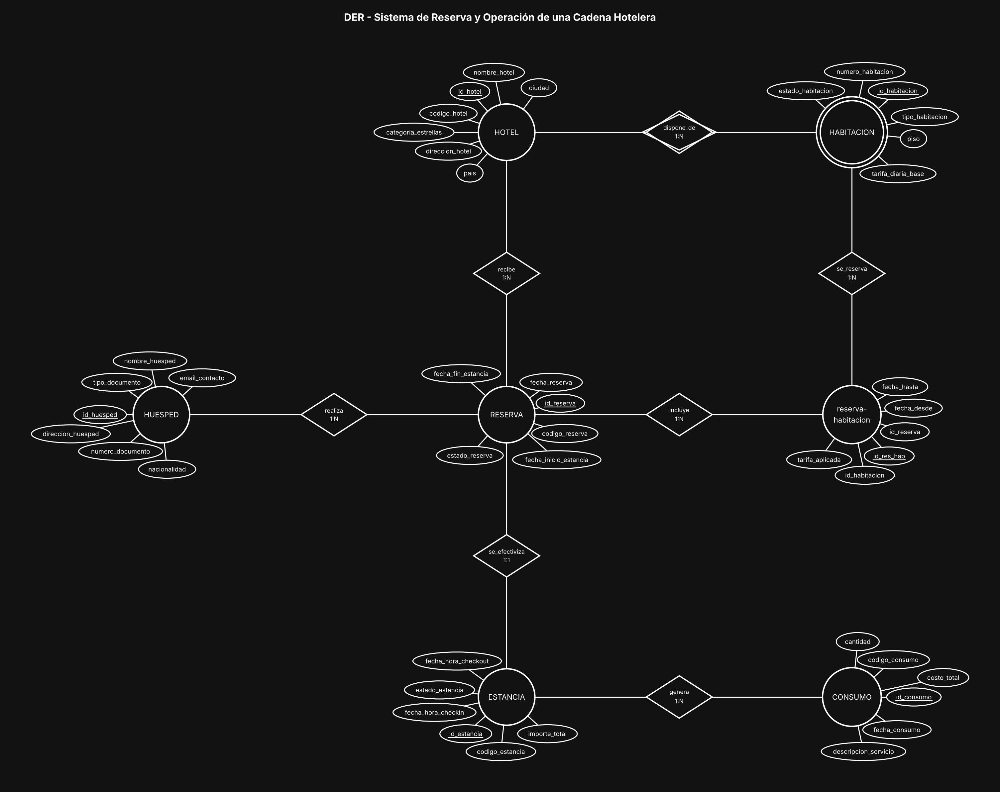

# BaseDeDatos-U1-Ej07-CadenaHotelera

Base de Datos - Unidad 1 - Ejercicio 7

## Consigna

Modelar el sistema centralizado de una cadena hotelera: hoteles con sus habitaciones, huéspedes, reservas que toman una o más habitaciones para un rango de fechas, el registro de check-in / check-out y los consumos de servicios adicionales durante la estancia.

## Lógica

**HABITACION como entidad débil de HOTEL.** El número de habitación no es único en la cadena: la 101 existe en todos los hoteles. Su PK es `id_habitacion`, y la identidad lógica es el par `id_hotel` (FK que llega de HOTEL) + `numero_habitacion`, declarado UNIQUE compuesto. La relación `dispone_de` es identificatoria (por eso el círculo y el rombo dobles). Sin el hotel, la habitación no se identifica ni existe.

**Reserva ↔ Habitación: N:M con `reserva-habitacion`.** Una reserva puede tomar varias habitaciones y una habitación se reserva muchas veces a lo largo del tiempo. La intermedia guarda `fecha_desde`, `fecha_hasta` y `tarifa_aplicada`.

**Control temporal contra solapamientos.** Las fechas están duplicadas a propósito en dos niveles: en RESERVA (`fecha_inicio_estancia` / `fecha_fin_estancia`) como rango comercial de la reserva completa, y en `reserva-habitacion` (`fecha_desde` / `fecha_hasta`) como ocupación efectiva de **cada** habitación. El chequeo de disponibilidad se hace sobre la intermedia: una habitación está libre si no existe ninguna fila con el mismo `id_habitacion` cuyo rango se cruce con el pedido (`fecha_desde < fecha_fin_pedida AND fecha_hasta > fecha_inicio_pedida`) y cuya reserva no esté en estado Cancelada. Poner las fechas solamente en RESERVA no alcanza, porque una reserva puede tener una habitación entrando el día 3 y otra el día 5. `tarifa_aplicada` se guarda acá y no se lee de HABITACION porque la tarifa base cambia con el tiempo y el precio pactado en la reserva tiene que quedar congelado.

**ESTANCIA separada de RESERVA (1:1).** La reserva es la intención (se puede cancelar y nunca ocurrir); la estancia es el hecho real, con `fecha_hora_checkin` y `fecha_hora_checkout`. Separarlas evita dejar esos campos en NULL en todas las reservas Confirmadas o Canceladas, y da el enganche natural para los consumos.

**CONSUMO colgado de ESTANCIA, no del huésped.** La consigna pide asociar el consumo directamente a la estancia en curso. Si colgara de HUESPED habría que adivinar a qué visita corresponde cada gasto; colgado de la estancia, la cuenta de cada visita cierra sola sumando `costo_total`. Los servicios se registran como `descripcion_servicio` dentro del consumo, siguiendo el enunciado. Si se quisiera normalizar el catálogo (precios por hotel, altas y bajas de servicios), se agregaría una entidad SERVICIO con HOTEL 1:N SERVICIO y CONSUMO pasaría a ser la intermedia `estancia-servicio`.

**HUESPED** lleva PK `id_huesped` y un UNIQUE compuesto sobre `tipo_documento` + `numero_documento`, porque un mismo número puede repetirse entre distintos tipos y países en una cadena internacional.

**Convención de claves.** Toda entidad lleva como PK un identificador propio `id_<entidad>` (subrayado en el diagrama) y al menos 5 atributos además del id; el código o documento de negocio (`dni`, `codigo_*`, `legajo`, etc.) queda como atributo común con restricción UNIQUE. Las entidades intermedias de las relaciones N:M llevan los tres ids: el propio y las dos FK de las entidades que unen (UNIQUE compuesto sobre ambas FK).

## Resultado

